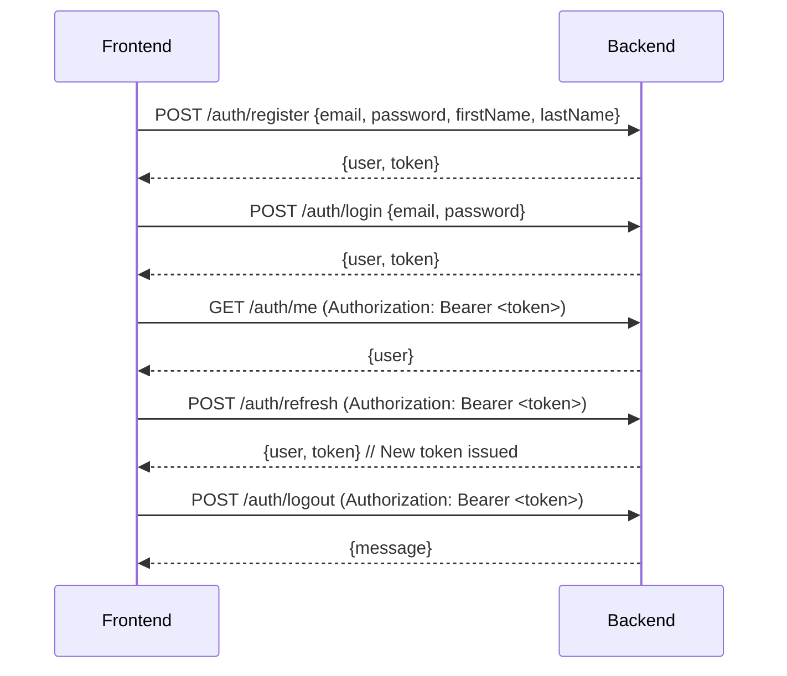
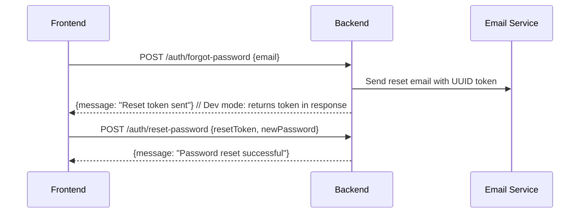

# Gamatutor Backend API Documentation

**Version**: 1.2.0  
**Base URL**: `http://localhost:3000/api` (development)  
**Environment**: Node.js + Express + PostgreSQL (Sequelize ORM)  
**Last Updated**: 2026-10-28

---

## Table of Contents

1. [Authentication & Credentials](#authentication--credentials)
2. [Error Handling](#error-handling)
3. [Common Query Parameters](#common-query-parameters)
4. [API Endpoints](#api-endpoints)
   - [Authentication](#1-authentication-auth)
   - [User Management](#2-user-management-users)
   - [Cards](#3-cards-cards)
   - [Card Lists (Subtasks)](#4-card-lists-subtasks-cardscardidlists)
   - [Chat (Direct Messages)](#5-chat-direct-messages-chat)
   - [Friendships](#6-friendships-friendships)
   - [Notifications](#7-notifications-notifications)
   - [User Avatar](#8-user-avatar-user-avatar)
   - [Avatar Components](#9-avatar-components-avatar-components)
   - [Avatar Unlocks](#10-avatar-unlocks-avatar-unlocks)
   - [Card List Collaborations](#11-card-list-collaborations-card-list-collabs)
   - [Card List Chat](#12-card-list-chat-card-list-chat)
   - [Column Movements](#13-column-movements-column-movements)
   - [Learning Strategies](#14-learning-strategies-learning-strategies)
   - [LLM Prompt Templates](#15-llm-prompt-templates-llm-prompt-templates)
   - [LLM Recommendation History](#16-llm-recommendation-history-llm-recommendation-history)
   - [Monthly Evaluations](#17-monthly-evaluations-monthly-evaluations)
   - [MSLQ Static Questions](#18-mslq-static-questions-mslq-static-questions)
   - [User Activity Logs](#19-user-activity-logs-user-activity-logs)
   - [User Quiz Results](#20-user-quiz-results-user-quiz-results)
   - [Calls (1:1)](#21-calls-11-calls)
   - [Group Calls](#22-group-calls-group-calls)
   - [Board](#23-board-board)
   - [Progress](#24-progress-progress)
   - [LLM Quiz & Recommendations](#25-llm-quiz--recommendations-llmrekomen)
5. [Data Models Reference](#data-models-reference)
6. [WebSocket Signaling](#websocket-signaling-contract-wschat)
7. [Frontend Integration Guide](#frontend-integration-guide)

---

## Authentication & Credentials

### JWT Token Authentication

All protected endpoints require a **Bearer Token** in the Authorization header:

```http
Authorization: Bearer <access_token>
```

### Token Lifecycle

| Token Type | Expiry | Storage | Description |
|------------|--------|---------|-------------|
| Access Token | 7 days | Database (`Token` table) | Used for API authentication |
| Refresh Token | N/A (replaces access token) | Database | Rotates on `/auth/refresh` |
| Reset Token | 1 hour | User model (`resetToken`) | Password reset flow |

### Credentials Required for Frontend Integration

```typescript
// Frontend auth service needs to handle:
interface AuthCredentials {
  // For login
  email: string;
  password: string;
  
  // For registration
  firstName: string;
  lastName: string;
  email: string;
  password: string; // 6-16 chars
  username: string; // auto-generated from email if not provided
  role?: 'user' | 'admin'; // default: 'user'
  status?: 'online' | 'offline'; // default: 'offline'
  
  // For password reset
  resetToken: string; // UUID from email
  newPassword: string; // 6-16 chars
}

// Token management
interface TokenResponse {
  user: User;
  token: string; // JWT access token
}
```

### Authentication Flow



### Password Reset Flow



---

## Error Handling

All errors follow a consistent format:

```json
{
  "error": "Error message",
  "errors": [
    {
      "field": "email",
      "message": "Invalid email format"
    }
  ]
}
```

### HTTP Status Codes

| Code | Description | When |
|------|-------------|------|
| 200 | OK | Successful GET, PUT |
| 201 | Created | Successful POST |
| 400 | Bad Request | Validation errors |
| 401 | Unauthorized | Missing/invalid/expired token |
| 403 | Forbidden | Insufficient permissions (admin required) |
| 404 | Not Found | Resource doesn't exist |
| 500 | Internal Server Error | Unexpected server error |

### Common Validation Errors

```json
{
  "errors": [
    { "field": "email", "message": "Valid email is required" },
    { "field": "password", "message": "Password must be 6-16 characters" },
    { "field": "learningId", "message": "Valid learning strategy ID is required" }
  ]
}
```

---

## Common Query Parameters

Most list endpoints support pagination and filtering:

| Parameter | Type | Default | Description |
|-----------|------|---------|-------------|
| `limit` | integer | 50 | Max items to return (max 100) |
| `offset` | integer | 0 | Items to skip |

### Filter Examples

```bash
# Pagination
GET /api/cards?limit=20&offset=0

# Filter by type
GET /api/notifications?type=push&read=false

# Date range
GET /api/column-movements?fromDate=2024-01-01&toDate=2024-12-31

# User-specific
GET /api/friendships/user/123e4567-e89b-12d3-a456-426614174000/friends
```

---

## API Endpoints

### 1. Authentication (`/auth`)

#### Register User
```http
POST /auth/register
Content-Type: application/json

{
  "email": "user@example.com",
  "password": "securePass123",
  "firstName": "John",
  "lastName": "Doe",
  "username": "johndoe",           // optional, auto-generated from email
  "role": "user",                  // optional, default: "user"
  "status": "offline"              // optional, default: "offline"
}
```

**Response (201)**:
```json
{
  "user": {
    "userId": "uuid",
    "email": "user@example.com",
    "firstName": "John",
    "lastName": "Doe",
    "username": "johndoe",
    "role": "user",
    "status": "offline",
    "createdAt": "2024-01-15T10:30:00.000Z"
  },
  "token": "eyJhbGciOiJIUzI1NiIsInR5cCI6IkpXVCJ9..."
}
```

#### Login
```http
POST /auth/login
Content-Type: application/json

{
  "email": "user@example.com",
  "password": "securePass123"
}
```

**Response (200)**: Same as register

#### Get Current User
```http
GET /auth/me
Authorization: Bearer <token>
```

**Response (200)**:
```json
{
  "userId": "uuid",
  "email": "user@example.com",
  "firstName": "John",
  "lastName": "Doe",
  "username": "johndoe",
  "role": "user",
  "status": "online",
  "createdAt": "2024-01-15T10:30:00.000Z"
}
```

#### Refresh Token
```http
POST /auth/refresh
Authorization: Bearer <token>
```

**Response (200)**: New `{user, token}` — old token invalidated

#### Logout
```http
POST /auth/logout
Authorization: Bearer <token>
```

**Response (200)**:
```json
{ "message": "Logged out successfully" }
```

#### Forgot Password
```http
POST /auth/forgot-password
Content-Type: application/json

{
  "email": "user@example.com"
}
```

**Response (200)**:
```json
{ "message": "Password reset token sent to email" }
// Development mode: { "message": "...", "resetToken": "uuid" }
```

#### Reset Password
```http
POST /auth/reset-password
Content-Type: application/json

{
  "resetToken": "uuid-from-email",
  "newPassword": "newSecurePass123"
}
```

**Response (200)**:
```json
{ "message": "Password has been reset successfully" }
```

---

### 2. User Management (`/users`)

> **All endpoints require authentication**

#### Get All Users (Admin)
```http
GET /users?limit=50&offset=0
Authorization: Bearer <token>
```

**Response (200)**:
```json
{
  "users": [
    {
      "userId": "uuid",
      "email": "user@example.com",
      "firstName": "John",
      "lastName": "Doe",
      "username": "johndoe",
      "role": "user",
      "status": "online",
      "createdAt": "2024-01-15T10:30:00.000Z"
    }
  ],
  "total": 1
}
```

#### Get User by ID
```http
GET /users/:id
Authorization: Bearer <token>
```

#### Update User Profile
```http
PUT /users/:id
Authorization: Bearer <token>
Content-Type: application/json

{
  "firstName": "John",
  "lastName": "Doe",
  "username": "johndoe",
  "email": "new@example.com"
}
// Sensitive fields (password, role, status, resetToken) cannot be updated
```

#### Update User Status
```http
PUT /users/:id/status
Authorization: Bearer <token>
Content-Type: application/json

{
  "status": "online"  // or "offline"
}
```

#### Delete User (Admin)
```http
DELETE /users/:id
Authorization: Bearer <token>
```

#### Search Users by Email
```http
GET /users/search?email=john
Authorization: Bearer <token>
```

**Query Parameters**:
| Parameter | Type | Required | Description |
|-----------|------|----------|-------------|
| `email` | string | Yes | Partial email to search (case-insensitive) |

**Response (200)**:
```json
{
  "users": [
    {
      "userId": "uuid",
      "email": "john@example.com",
      "firstName": "John",
      "lastName": "Doe",
      "username": "johndoe",
      "role": "user",
      "status": "online",
      "createdAt": "2024-01-15T10:30:00.000Z"
    }
  ]
}
```
Returns up to 10 matching users. Excludes password, resetToken, resetTokenExpiry.

---

### 3. Cards (`/cards`)

> **All endpoints require authentication**  
> Cards are scoped to the authenticated user

#### Create Card
```http
POST /cards
Authorization: Bearer <token>
Content-Type: application/json

{
  "title": "Learn React",                 // required, max 255
  "learningId": "uuid-of-learning-strat", // required
  "description": "Master React hooks",     // optional
  "courseName": "Frontend Development",   // optional, max 50
  "difficulty": "medium",                 // optional: easy|medium|hard|expert
  "priority": "high",                     // optional: low|medium|high|critical
  "deadline": "2024-12-31",               // required, YYYY-MM-DD
  "url": "https://react.dev",             // optional
  "startTime": "2024-01-15T10:00:00Z",    // optional, ISO8601
  "endTime": "2024-01-15T12:00:00Z"       // optional, ISO8601
}
```

**Response (201)**:
```json
{
  "cardId": "uuid",
  "userId": "uuid",
  "title": "Learn React",
  "learningId": "uuid",
  "learningStrat": {
    "learningId": "uuid",
    "learningStrategy": "elaboration",
    "keyCode": "ELAB"
  },
  "description": "Master React hooks",
  "courseName": "Frontend Development",
  "difficulty": "medium",
  "priority": "high",
  "deadline": "2024-12-31",
  "url": "https://react.dev",
  "startTime": "2024-01-15T10:00:00.000Z",
  "endTime": "2024-01-15T12:00:00.000Z",
  "deleted": false,
  "createdAt": "2024-01-15T10:30:00.000Z"
}
```

#### List Cards
```http
GET /cards?limit=50&offset=0&difficulty=medium&priority=high
Authorization: Bearer <token>
```

**Filters**: `difficulty`, `priority`, `deleted`, `learningId`, `courseName`

#### Get Card by ID
```http
GET /cards/:id
Authorization: Bearer <token>
```

**Response**: Includes nested `learningStrat`, `cardList` (subtasks), `columnMovements`, `collaborations`

#### Update Card
```http
PUT /cards/:id
Authorization: Bearer <token>
Content-Type: application/json

{
  "title": "Advanced React",
  "description": "Deep dive into hooks",
  "difficulty": "hard",
  "priority": "critical",
  "subtasks": [                          // optional: replaces ALL subtasks
    { "subTitle": "useState", "startTimeList": "...", "endTimeList": "..." },
    { "subTitle": "useEffect", "startTimeList": "...", "endTimeList": "..." }
  ]
}
```

**Special behavior**: Sending `subtasks` array performs **bulk replace** (deletes existing, creates new). Timestamp changes auto-create `ColumnMovement` records.

#### Delete Card
```http
DELETE /cards/:id
Authorization: Bearer <token>
```

---

### 4. Card Lists / Subtasks (`/cards/:cardId/lists`)

> **All endpoints require authentication**  
> Uses `mergeParams: true` — `cardId` from parent route  
> **Primary route: `/api/cards/:cardId/lists` (plural)** — `/api/cards/:cardId/list` (singular) also mounted as legacy alias

#### Create Subtask
```http
POST /cards/:cardId/lists
Authorization: Bearer <token>
Content-Type: application/json

{
  "subTitle": "Implement useState",
  "startTimeList": "2024-01-15T10:00:00Z",
  "endTimeList": "2024-01-15T11:00:00Z"
}
```

**Note**: Legacy alias `POST /cards/:cardId/list` also works.

#### List Subtasks
```http
GET /cards/:cardId/lists
Authorization: Bearer <token>
```

**Note**: Legacy alias `GET /cards/:cardId/list` also works.

#### Update Subtask
```http
PUT /cards/:cardId/lists/:clId
Authorization: Bearer <token>
Content-Type: application/json

{
  "subTitle": "Implement useState & useReducer",
  "endTimeList": "2024-01-15T11:30:00Z"
}
```

**Note**: Legacy alias `PUT /cards/:cardId/list/:clId` also works.

#### Delete Subtask
```http
DELETE /cards/:cardId/lists/:clId
Authorization: Bearer <token>
```

**Note**: Legacy alias `DELETE /cards/:cardId/list/:clId` also works.

---

### 5. Chat - Direct Messages (`/chat`)

> **All endpoints require authentication**

#### Send Message
```http
POST /chat
Authorization: Bearer <token>
Content-Type: application/json

{
  "friendId": "uuid-of-recipient",
  "messageChat": "Hey, how's it going?",
  "status": "delivered"  // optional: delivered|read, default: delivered
}
```

#### List Messages
```http
GET /chat?limit=50&offset=0&userId=uuid-of-other-user
Authorization: Bearer <token>
```

#### Get Messages with Specific User
```http
GET /chat/user/:userId?limit=50&offset=0
Authorization: Bearer <token>
```

#### Get Message by ID
```http
GET /chat/:id
Authorization: Bearer <token>
```

#### Update Message
```http
PUT /chat/:id
Authorization: Bearer <token>
Content-Type: application/json

{
  "messageChat": "Edited message",
  "status": "read"
}
```

#### Delete Message
```http
DELETE /chat/:id
Authorization: Bearer <token>
```

---

### 6. Friendships (`/friendships`)

> **All endpoints require authentication**

#### Send Friend Request
```http
POST /friendships
Authorization: Bearer <token>
Content-Type: application/json

{
  "friendId": "uuid-of-target-user"
}
```

#### List All Friendships
```http
GET /friendships?status=pending&limit=50&offset=0
Authorization: Bearer <token>
```

**Filters**: `status` (pending|accepted|declined|blocked)

#### Get User's Friends
```http
GET /friendships/user/:userId/friends?limit=50&offset=0
Authorization: Bearer <token>
```

#### Get Pending Requests
```http
GET /friendships/user/:userId/pending?limit=50&offset=0
Authorization: Bearer <token>
```

#### Get Friendship by ID
```http
GET /friendships/:fsId
Authorization: Bearer <token>
```

#### Accept Friend Request
```http
PUT /friendships/:fsId/accept
Authorization: Bearer <token>
// Only the recipient can accept
```

#### Block User
```http
PUT /friendships/:fsId/block
Authorization: Bearer <token>
// Either party can block
```

#### Reject Friend Request
```http
PUT /friendships/:fsId/reject
Authorization: Bearer <token>
// Only the recipient can reject
```

#### Remove Friendship
```http
DELETE /friendships/:fsId
Authorization: Bearer <token>
// Either party can remove
```

#### Unblock User
```http
PUT /friendships/:fsId/unblock
Authorization: Bearer <token>
// Either party can unblock a blocked friendship
```

**Response (200)**:
```json
{
  "fsId": "uuid",
  "userId": "uuid",
  "friendId": "uuid",
  "status": "declined",
  "requester": { "userId": "...", "firstName": "...", "lastName": "...", "username": "..." },
  "friend": { "userId": "...", "firstName": "...", "lastName": "...", "username": "..." },
  "createdAt": "2024-01-15T10:30:00.000Z",
  "updatedAt": "2024-01-20T15:45:00.000Z"
}
```

**Behavior**: Changes friendship status from `blocked` to `declined`. Requires the friendship to currently be in `blocked` status.

---

### 7. Notifications (`/notifications`)

> **All endpoints require authentication**

#### Create Notification (Admin typically)
```http
POST /notifications
Authorization: Bearer <token>
Content-Type: application/json

{
  "userId": "uuid",                              // required
  "type": "push",                                // required: push|smart_reminder|social_presence|encouragement
  "title": "New friend request",                 // optional, max 255
  "message": "John sent you a friend request",   // required
  "scheduledFor": "2024-01-15T10:00:00Z",        // optional, future delivery
  "reminderReason": "friend_request",            // optional
  "triggerAction": "friend_request_received",    // optional
  "triggerUserId": "uuid-of-trigger-user"        // optional
}
```

#### List Notifications
```http
GET /notifications?type=push&read=false&delivered=true&limit=50&offset=0
Authorization: Bearer <token>
```

**Filters**: `type`, `read`, `delivered`

#### Get Notification by ID
```http
GET /notifications/:notifId
Authorization: Bearer <token>
```

#### Mark as Read
```http
PUT /notifications/:notifId/read
Authorization: Bearer <token>
```

#### Mark as Clicked
```http
PUT /notifications/:notifId/click
Authorization: Bearer <token>
```

#### Mark All as Read
```http
PUT /notifications/read-all
Authorization: Bearer <token>
```

#### Update Notification
```http
PUT /notifications/:notifId
Authorization: Bearer <token>
Content-Type: application/json

{
  "title": "Updated title",
  "message": "Updated message"
}
```

#### Delete Notification
```http
DELETE /notifications/:notifId
Authorization: Bearer <token>
```

---

### 8. User Avatar (`/user-avatar`)

> **All endpoints require authentication**  
> Scoped to authenticated user

#### Get Current User's Avatar
```http
GET /user-avatar
Authorization: Bearer <token>
```

**Response (200)**:
```json
{
  "userId": "uuid",
  "hairId": "uuid",
  "faceId": "uuid",
  "shirtId": "uuid",
  "pantsId": "uuid",
  "specialId": "uuid",
  "hair": { "avaId": "uuid", "category": "hair", "name": "Short Hair", "assetPath": "/assets/hair/short.png" },
  "face": { "avaId": "uuid", "category": "face", "name": "Smile", "assetPath": "/assets/face/smile.png" },
  "shirt": { "avaId": "uuid", "category": "shirt", "name": "T-Shirt", "assetPath": "/assets/shirt/tshirt.png" },
  "pants": { "avaId": "uuid", "category": "pants", "name": "Jeans", "assetPath": "/assets/pants/jeans.png" },
  "special": { "avaId": "uuid", "category": "special", "name": "Cape", "assetPath": "/assets/special/cape.png" },
  "updatedAt": "2024-01-15T10:30:00.000Z"
}
```

#### Update Avatar
```http
PUT /user-avatar
Authorization: Bearer <token>
Content-Type: application/json

{
  "hairId": "uuid-of-hair-component",
  "faceId": "uuid-of-face-component",
  "shirtId": "uuid-of-shirt-component",
  "pantsId": "uuid-of-pants-component",
  "specialId": "uuid-of-special-component"
}
// All fields optional — only provide what you want to change
// Each componentId must exist AND match the correct category
```

---

### 9. Avatar Components (`/avatar-components`)

> **Read: All authenticated users**  
> **Write: Admin only**

#### Seed Data
**23 avatar components pre-seeded** via `scripts/seed-avatar-components.js`:
| Category | Components (5 each except head: 1) |
|----------|-------------------------------------|
| head | Default Head |
| hair | Short Hair, Long Hair, Curly Hair, Bald, Ponytail |
| face | Smile, Serious, Wink, Glasses, Blush |
| shirt | T-Shirt, Hoodie, Formal Shirt, Tank Top |
| pants | Jeans, Shorts, Sweatpants, Formal Pants |
| special | Cape, Wings, Halo, Backpack |

All components have valid UUIDs in database. Frontend can use local fallback assets but should sync with these UUIDs for persistence.

#### Create Component (Admin)
```http
POST /avatar-components
Authorization: Bearer <admin-token>
Content-Type: application/json

{
  "category": "hair",                          // required: head|hair|face|shirt|pants|special
  "name": "Long Hair",                         // required, max 50
  "assetPath": "/assets/hair/long.png"         // required
}
```

#### List Components
```http
GET /avatar-components?category=hair&limit=50&offset=0
Authorization: Bearer <token>
```

#### Get by Category
```http
GET /avatar-components/category/:category
Authorization: Bearer <token>
```

#### Get by ID
```http
GET /avatar-components/:id
Authorization: Bearer <token>
```

#### Update Component (Admin)
```http
PUT /avatar-components/:id
Authorization: Bearer <admin-token>
Content-Type: application/json

{
  "category": "hair",
  "name": "Updated Long Hair",
  "assetPath": "/assets/hair/long_v2.png"
}
```

#### Delete Component (Admin)
```http
DELETE /avatar-components/:id
Authorization: Bearer <admin-token>
```

---

### 10. Avatar Unlocks (`/avatar-unlocks`)

> **All endpoints require authentication**

#### Unlock Component for User
```http
POST /avatar-unlocks
Authorization: Bearer <token>
Content-Type: application/json

{
  "componentId": "uuid-of-avatar-component"
}
// User must not already have this component unlocked
```

#### List Unlocks
```http
GET /avatar-unlocks?userId=uuid&componentId=uuid&limit=50&offset=0
Authorization: Bearer <token>
```

#### Get User's Unlocks
```http
GET /avatar-unlocks/user/:userId
Authorization: Bearer <token>
```
**Special value**: Use `me` as `:userId` to get current authenticated user's unlocks (e.g., `GET /avatar-unlocks/user/me`)

#### Get Unlocks by Component
```http
GET /avatar-unlocks/component/:componentId
Authorization: Bearer <token>
```

#### Check if Unlocked
```http
GET /avatar-unlocks/check/:componentId
Authorization: Bearer <token>
```

**Response**:
```json
{ "unlocked": true }
```

#### Get Unlock by ID
```http
GET /avatar-unlocks/:id
Authorization: Bearer <token>
```

#### Delete Unlock Record
```http
DELETE /avatar-unlocks/:id
Authorization: Bearer <token>
```

---

### 11. Card List Collaborations (`/card-list-collabs`)

> **All endpoints require authentication**

#### Add Collaborator
```http
POST /card-list-collabs/card/:cardId
Authorization: Bearer <token>
Content-Type: application/json

{
  "userId": "uuid-of-collaborator",
  "role": "member"  // optional: owner|member, default: member
}
// Prevents duplicate collaborators
```

#### List Collaborations
```http
GET /card-list-collabs?cardId=uuid&userId=uuid&role=member&limit=50&offset=0
Authorization: Bearer <token>
```

#### Get Collaborations for Card
```http
GET /card-list-collabs/card/:cardId
Authorization: Bearer <token>
```

#### Get User's Collaborations
```http
GET /card-list-collabs/user/:userId
Authorization: Bearer <token>
```

#### Get Collaboration by ID
```http
GET /card-list-collabs/:id
Authorization: Bearer <token>
```

#### Update Collaborator Role
```http
PUT /card-list-collabs/:id/role
Authorization: Bearer <token>
Content-Type: application/json

{
  "role": "owner"  // owner|member
}
```

#### Remove Collaborator
```http
DELETE /card-list-collabs/:id
Authorization: Bearer <token>
```

---

### 12. Card List Chat (`/card-list-chat`)

> **All endpoints require authentication**

#### Send Message to Collaboration
```http
POST /card-list-chat/collab/:collabId
Authorization: Bearer <token>
Content-Type: application/json

{
  "message": "Let's work on this together!"
}
```

#### List Messages
```http
GET /card-list-chat?collabId=uuid&userId=uuid&limit=50&offset=0
Authorization: Bearer <token>
```

#### Get Messages for Collaboration
```http
GET /card-list-chat/collab/:collabId?limit=50&offset=0
Authorization: Bearer <token>
// Messages ordered by sentAt ASC (conversation view)
```

#### Get Message by ID
```http
GET /card-list-chat/:id
Authorization: Bearer <token>
```

#### Update Message
```http
PUT /card-list-chat/:id
Authorization: Bearer <token>
Content-Type: application/json

{
  "message": "Edited message"
}
```

#### Delete Message
```http
DELETE /card-list-chat/:id
Authorization: Bearer <token>
```

---

### 13. Column Movements (`/column-movements`)

> **All endpoints require authentication**

#### Create Column Movement
```http
POST /column-movements
Authorization: Bearer <token>
Content-Type: application/json

{
  "cardId": "uuid",
  "fromColumn": "planning",
  "toColumn": "monitoring"
}
```

#### List Movements
```http
GET /column-movements?cardId=uuid&completed=false&fromDate=2024-01-01&toDate=2024-12-31&limit=50&offset=0
Authorization: Bearer <token>
```

**Filters**: `cardId`, `completed`, `fromDate`, `toDate` (ISO8601)

#### Get Movements for Card
```http
GET /column-movements/card/:cardId
Authorization: Bearer <token>
// Ordered by timestamp ASC (history view)
```

#### Get Movement by ID
```http
GET /column-movements/:id
Authorization: Bearer <token>
```

#### Update Movement
```http
PUT /column-movements/:id
Authorization: Bearer <token>
Content-Type: application/json

{
  "fromColumn": "planning",
  "toColumn": "controlling",
  "completed": true
}
```

#### Mark Completed
```http
PUT /column-movements/:id/complete
Authorization: Bearer <token>
```

#### Delete Movement
```http
DELETE /column-movements/:id
Authorization: Bearer <token>
```

---

### 14. Learning Strategies (`/learning-strats`)

> **All endpoints require authentication**  
> **Primary route: `/api/learning-strats`** — `/api/learning-strategies` also mounted as alias (both work)

#### Valid Strategy Names & KeyCodes
| keyCode | learningStrategy |
|---------|------------------|
| REH | rehearsal |
| ORG | organization |
| ELAB | elaboration |
| TM | time management |
| HS | help seeking |
| MSR | metacognitive self regulation |
| CT | critical thinking |

#### Create Strategy (Admin)
```http
POST /learning-strats
Authorization: Bearer <admin-token>
Content-Type: application/json

{
  "keyCode": "ELAB",
  "learningStrategy": "elaboration",
  "description": "Connecting new info to existing knowledge"
}
```

#### List Strategies
```http
GET /learning-strats
Authorization: Bearer <token>
```

#### Get by ID
```http
GET /learning-strats/:learningId
Authorization: Bearer <token>
```

#### Get by Name
```http
GET /learning-strats/:learningStrategy
Authorization: Bearer <token>
// Case-insensitive, must be one of the 7 valid names
```

#### Update Strategy (Admin)
```http
PUT /learning-strats/:id
Authorization: Bearer <admin-token>
Content-Type: application/json

{
  "keyCode": "ELAB",
  "learningStrategy": "elaboration",
  "description": "Updated description"
}
```

#### Delete Strategy (Admin)
```http
DELETE /learning-strats/:id
Authorization: Bearer <admin-token>
```

---

### 15. LLM Prompt Templates (`/llm-prompt-templates`)

> **All endpoints require Admin authentication**

#### Create Template
```http
POST /llm-prompt-templates
Authorization: Bearer <admin-token>
Content-Type: application/json

{
  "templateName": "monthly_evaluation_prompt",
  "systemPrompt": "You are an educational coach...",
  "version": 1,
  "isActive": true
}
```

#### List Templates
```http
GET /llm-prompt-templates?isActive=true&templateName=monthly&limit=50&offset=0
Authorization: Bearer <admin-token>
```

#### Get by Name
```http
GET /llm-prompt-templates/name/:templateName
Authorization: Bearer <admin-token>
```

#### Get by ID
```http
GET /llm-prompt-templates/:id
Authorization: Bearer <admin-token>
```

#### Update Template
```http
PUT /llm-prompt-templates/:id
Authorization: Bearer <admin-token>
Content-Type: application/json

{
  "templateName": "updated_name",
  "systemPrompt": "Updated prompt...",
  "version": 2,
  "isActive": true
}
```

#### Delete Template
```http
DELETE /llm-prompt-templates/:id
Authorization: Bearer <admin-token>
```

---

### 16. LLM Recommendation History (`/llm-recommendation-history`)

> **All endpoints require authentication**  
> **List/Delete all: Admin only**

#### Create History Record
```http
POST /llm-recommendation-history
Authorization: Bearer <token>
Content-Type: application/json

{
  "triggerType": "monthly_evaluation",
  "inputContext": {
    "userId": "uuid",
    "monthYear": "01-2024",
    "quizResults": { "dominantStrategy": "elaboration" }
  },
  "llmOutput": {
    "recommendations": ["Focus on elaboration techniques", "Try concept mapping"],
    "confidence": 0.85
  }
}
```

#### List All (Admin)
```http
GET /llm-recommendation-history?userId=uuid&triggerType=monthly_evaluation&limit=50&offset=0
Authorization: Bearer <admin-token>
```

#### Get User's History
```http
GET /llm-recommendation-history/user/:userId?triggerType=monthly_evaluation&limit=50&offset=0
Authorization: Bearer <token>
```

#### Get by Trigger Type
```http
GET /llm-recommendation-history/trigger/:triggerType
Authorization: Bearer <token>
```

#### Get by ID
```http
GET /llm-recommendation-history/:id
Authorization: Bearer <token>
```

#### Delete History (Admin)
```http
DELETE /llm-recommendation-history/:id
Authorization: Bearer <admin-token>
```

---

### 17. Monthly Evaluations (`/monthly-evaluations`)

> **Create/Read own: User**  
> **Write/Delete all: Admin only**  
> **One evaluation per user per month enforced**

#### Create Evaluation
```http
POST /monthly-evaluations
Authorization: Bearer <token>
Content-Type: application/json

{
  "monthYear": "01-2024",                 // required, format: MM-YYYY
  "isSynchronized": false,                // required
  "requiresQuizRetake": false,            // optional, default: false
  "detectedIssues": {                     // required, JSON object
    "lowEngagement": true,
    "missedDeadlines": 3
  },
  "llmFeedback": "Consider focusing on time management strategies..."
}
```

#### List All (Admin)
```http
GET /monthly-evaluations?userId=uuid&monthYear=01-2024&isSynchronized=true&limit=50&offset=0
Authorization: Bearer <admin-token>
```

#### Get User's Evaluations
```http
GET /monthly-evaluations/user/:userId?monthYear=01-2024&limit=50&offset=0
Authorization: Bearer <token>
```

#### Get Specific Month
```http
GET /monthly-evaluations/user/:userId/month/:monthYear
Authorization: Bearer <token>
```

#### Get by ID
```http
GET /monthly-evaluations/:id
Authorization: Bearer <token>
```

#### Update Evaluation (Admin)
```http
PUT /monthly-evaluations/:id
Authorization: Bearer <admin-token>
Content-Type: application/json

{
  "monthYear": "01-2024",
  "isSynchronized": true,
  "requiresQuizRetake": false,
  "detectedIssues": {},
  "llmFeedback": "Updated feedback"
}
```

#### Delete Evaluation (Admin)
```http
DELETE /monthly-evaluations/:id
Authorization: Bearer <admin-token>
```

---

### 18. MSLQ Static Questions (`/mslq-static-questions`)

> **Read: All authenticated users**  
> **Write: Admin only**

#### Create Question (Admin)
```http
POST /mslq-static-questions
Authorization: Bearer <admin-token>
Content-Type: application/json

{
  "category": "motivation",               // or "learning_strategies"
  "questionText": "I prefer challenging tasks...",
  "options": {                            // required, JSON object
    "1": "Not at all true of me",
    "2": "Slightly true",
    "3": "Somewhat true",
    "4": "Very true",
    "5": "Completely true of me"
  }
}
```

#### List Questions
```http
GET /mslq-static-questions?category=motivation&limit=50&offset=0
Authorization: Bearer <token>
```

#### Get by Category
```http
GET /mslq-static-questions/category/:category
Authorization: Bearer <token>
```

#### Get by ID
```http
GET /mslq-static-questions/:id
Authorization: Bearer <token>
```

#### Update Question (Admin)
```http
PUT /mslq-static-questions/:id
Authorization: Bearer <admin-token>
Content-Type: application/json

{
  "category": "motivation",
  "questionText": "Updated question...",
  "options": { ... }
}
```

#### Delete Question (Admin)
```http
DELETE /mslq-static-questions/:id
Authorization: Bearer <admin-token>
```

---

### 19. User Activity Logs (`/user-activity-logs`)

> **Create/Read own: User**  
> **List/Delete all: Admin only**

#### Create Activity Log
```http
POST /user-activity-logs
Authorization: Bearer <token>
Content-Type: application/json

{
  "activityType": "card_created",         // required
  "refId": "uuid-of-related-resource",    // optional
  "metadata": {                           // optional
    "cardTitle": "Learn React",
    "difficulty": "medium"
  }
}
```

#### List All (Admin)
```http
GET /user-activity-logs?userId=uuid&activityType=card_created&refId=uuid&limit=50&offset=0
Authorization: Bearer <admin-token>
```

#### Get User's Logs
```http
GET /user-activity-logs/user/:userId?activityType=card_created&limit=50&offset=0
Authorization: Bearer <token>
```

#### Get by Activity Type
```http
GET /user-activity-logs/type/:activityType?userId=uuid&limit=50&offset=0
Authorization: Bearer <token>
```

#### Get by ID
```http
GET /user-activity-logs/:id
Authorization: Bearer <token>
```

#### Delete Log (Admin)
```http
DELETE /user-activity-logs/:id
Authorization: Bearer <admin-token>
```

---

### 20. User Quiz Results (`/user-quiz-results`)

> **Create/Read own: User**  
> **List/Update/Delete all: Admin only**

#### Create Quiz Result
```http
POST /user-quiz-results
Authorization: Bearer <token>
Content-Type: application/json

{
  "dominantStrategy": "elaboration",
  "userProfile": "Active elaborator with strong metacognitive skills",
  "unlockedFeatures": ["avatar_hair_1", "avatar_face_2"],
  "lockedFeatures": ["avatar_special_1"],
  "answersPayload": {
    "q1": 4,
    "q2": 5,
    "q3": 3
  }
}
```

#### List All (Admin)
```http
GET /user-quiz-results?userId=uuid&dominantStrategy=elaboration&limit=50&offset=0
Authorization: Bearer <admin-token>
```

#### Get Latest for User
```http
GET /user-quiz-results/latest/:userId
Authorization: Bearer <token>
```

#### Get User's Results
```http
GET /user-quiz-results/user/:userId?limit=50&offset=0
Authorization: Bearer <token>
```

#### Get by ID
```http
GET /user-quiz-results/:id
Authorization: Bearer <token>
```

#### Update Result (Admin)
```http
PUT /user-quiz-results/:id
Authorization: Bearer <admin-token>
Content-Type: application/json

{
  "dominantStrategy": "elaboration",
  "userProfile": "Updated profile",
  "unlockedFeatures": [],
  "lockedFeatures": [],
  "answersPayload": {}
}
```

#### Delete Result (Admin)
```http
DELETE /user-quiz-results/:id
Authorization: Bearer <admin-token>
```

---

### 21. Calls (1:1) (`/calls`)

> **All endpoints require authentication**

#### Initiate Call
```http
POST /calls
Authorization: Bearer <token>
Content-Type: application/json

{
  "calleeId": "uuid-of-recipient",
  "type": "audio",  // or "video"
  "signalingData": {}  // optional WebRTC signaling data
}
```

**Response (201)**:
```json
{
  "call": {
    "callId": "uuid",
    "callerId": "uuid",
    "calleeId": "uuid",
    "type": "audio",
    "status": "pending",
    "startedAt": null,
    "endedAt": null,
    "duration": 0,
    "signalingData": {},
    "createdAt": "2024-01-15T10:30:00.000Z"
  }
}
```

#### Get Call History
```http
GET /calls?status=ended&fromDate=2024-01-01&toDate=2024-12-31&limit=50&offset=0
Authorization: Bearer <token>
```

**Query Parameters**:
| Parameter | Type | Description |
|-----------|------|-------------|
| `status` | string | Filter by status (pending, ringing, answered, rejected, ended, missed, cancelled) |
| `fromDate` | ISO8601 | Filter from date |
| `toDate` | ISO8601 | Filter to date |
| `limit` | integer | Default: 50 |
| `offset` | integer | Default: 0 |

**Response (200)**:
```json
{
  "calls": [
    {
      "callId": "uuid",
      "callerId": "uuid",
      "calleeId": "uuid",
      "type": "audio",
      "status": "ended",
      "startedAt": "2024-01-15T10:00:00.000Z",
      "endedAt": "2024-01-15T10:30:00.000Z",
      "duration": 1800,
      "createdAt": "2024-01-15T10:00:00.000Z"
    }
  ]
}
```

#### Get Call by ID
```http
GET /calls/:callId
Authorization: Bearer <token>
```

#### Answer Call
```http
PUT /calls/:callId/answer
Authorization: Bearer <token>
Content-Type: application/json

{
  "signalingData": {}  // WebRTC answer SDP
}
```

#### Reject Call
```http
PUT /calls/:callId/reject
Authorization: Bearer <token>
```

#### End Call
```http
PUT /calls/:callId/end
Authorization: Bearer <token>
```

#### Cancel Call
```http
PUT /calls/:callId/cancel
Authorization: Bearer <token>
```

#### Update Call Signaling
```http
PUT /calls/:callId/signaling
Authorization: Bearer <token>
Content-Type: application/json

{
  "signalingData": {}  // ICE candidates, etc.
}
```

---

### 22. Group Calls (`/group-calls`)

> **All endpoints require authentication**

#### Create Group Call
```http
POST /group-calls
Authorization: Bearer <token>
Content-Type: application/json

{
  "title": "Study Group Session",
  "type": "video",  // or "audio"
  "scheduledAt": "2024-01-20T14:00:00.000Z",  // optional
  "maxParticipants": 10,  // optional, default: 10
  "isRecording": false,  // optional
  "settings": {  // optional
    "allowScreenShare": true,
    "allowChat": true,
    "muteOnEntry": false
  }
}
```

**Response (201)**:
```json
{
  "groupCall": {
    "groupCallId": "uuid",
    "hostId": "uuid",
    "title": "Study Group Session",
    "type": "video",
    "status": "scheduled",
    "scheduledAt": "2024-01-20T14:00:00.000Z",
    "startedAt": null,
    "endedAt": null,
    "maxParticipants": 10,
    "isRecording": false,
    "settings": { ... },
    "createdAt": "2024-01-15T10:30:00.000Z"
  }
}
```

#### Get Group Call History
```http
GET /group-calls?status=ended&fromDate=2024-01-01&toDate=2024-12-31&limit=50&offset=0
Authorization: Bearer <token>
```

#### Get Group Call by ID
```http
GET /group-calls/:groupCallId
Authorization: Bearer <token>
```

#### Get Participants
```http
GET /group-calls/:groupCallId/participants
Authorization: Bearer <token>
```

#### Join Group Call
```http
POST /group-calls/:groupCallId/join
Authorization: Bearer <token>
Content-Type: application/json

{
  "signalingData": {}  // WebRTC offer SDP
}
```

#### Leave Group Call
```http
POST /group-calls/:groupCallId/leave
Authorization: Bearer <token>
```

#### End Group Call (Host only)
```http
POST /group-calls/:groupCallId/end
Authorization: Bearer <token>
```

#### Update Group Call Settings (Host only)
```http
PUT /group-calls/:groupCallId/settings
Authorization: Bearer <token>
Content-Type: application/json

{
  "title": "Updated Title",
  "isRecording": true,
  "settings": {
    "allowScreenShare": true,
    "allowChat": true,
    "muteOnEntry": true
  }
}
```

#### Update Participant (Host/Moderator)
```http
PUT /group-calls/:groupCallId/participants/:participantId
Authorization: Bearer <token>
Content-Type: application/json

{
  "role": "moderator",  // host, moderator, participant
  "isMuted": true,
  "isVideoEnabled": false,
  "isScreenSharing": true
}
```

---

### 23. Board (`/board`)

> **All endpoints require authentication**  
> Aggregated view for Kanban board display

#### Get Board Data
```http
GET /board?column=planning&limit=100&offset=0
Authorization: Bearer <token>
```

**Query Parameters**:
| Parameter | Type | Default | Description |
|-----------|------|---------|-------------|
| `column` | string | - | Filter by column (planning, monitoring, controlling, etc.) |
| `limit` | integer | 100 | Items per page |
| `offset` | integer | 0 | Items to skip |

**Response (200)**:
```json
{
  "planning": [
    {
      "cardId": "uuid",
      "title": "Learn React",
      "difficulty": "medium",
      "priority": "high",
      "deadline": "2024-12-31",
      "cardList": {
        "learningStrat": { "learningStrategy": "elaboration" }
      }
    }
  ],
  "monitoring": [ ... ],
  "controlling": [ ... ],
  "reflection": [ ... ]
}
```

#### Get Board Columns
```http
GET /board/columns
Authorization: Bearer <token>
```

**Response (200)**:
```json
{
  "columns": [
    { "id": "planning", "title": "Planning", "order": 1 },
    { "id": "monitoring", "title": "Monitoring", "order": 2 },
    { "id": "controlling", "title": "Controlling", "order": 3 },
    { "id": "reflection", "title": "Reflection", "order": 4 }
  ]
}
```

---

### 24. Progress (`/progress`)

> **All endpoints require authentication**  
> User learning progress analytics

#### Get Progress Summary
```http
GET /progress?period=week
Authorization: Bearer <token>
```

**Query Parameters**:
| Parameter | Type | Default | Description |
|-----------|------|---------|-------------|
| `period` | string | "week" | "week" \| "month" \| "all" |

**Response (200)**:
```json
{
  "summary": {
    "totalCards": 15,
    "completedCards": 8,
    "totalStudyTime": 3600,
    "averageGrade": 82.5,
    "dominantStrategy": "elaboration",
    "streakDays": 5
  },
  "growthData": [
    { "date": "2024-01-08", "cardsCompleted": 2, "studyTime": 7200 },
    { "date": "2024-01-09", "cardsCompleted": 1, "studyTime": 3600 }
  ]
}
```

#### Get All Cards for Progress
```http
GET /progress/board/cards/all
Authorization: Bearer <token>
```

**Response (200)**:
```json
{
  "cards": [
    {
      "cardId": "uuid",
      "title": "Learn React",
      "difficulty": "medium",
      "priority": "high",
      "deadline": "2024-12-31",
      "cardList": {
        "learningStrat": { "learningStrategy": "elaboration" },
        "startTime": "2024-01-15T10:00:00.000Z",
        "endTime": "2024-01-15T12:00:00.000Z",
        "postTestGrade": 85,
        "reflectionCompletedAt": "2024-01-15T12:30:00.000Z"
      }
    }
  ]
}
```

---

### 25. LLM Quiz & Recommendations (`/llmRekomen`)

> **All endpoints require authentication**  
> Dynamic MSLQ quiz generation and LLM-powered recommendations

#### Generate Dynamic Quiz Questions
```http
GET /llmRekomen/questions
Authorization: Bearer <token>
```

**Response (200)**:
```json
{
  "source": "llm",  // or "static_fallback"
  "questions": [
    {
      "staticQId": "uuid",
      "category": "planning",
      "questionText": "Saya membuat jadwal belajar sebelum memulai...",
      "options": {
        "1": "Tidak pernah",
        "2": "Kadang-kadang",
        "3": "Sering"
      }
    }
    // ... 24 questions total (4 per category: planning, monitoring, controlling, reflection, help_seeking, effort)
  ]
}
```

**Note**: Questions use 6 MSLQ categories with 4 questions each = 24 total. Options are 3-point scale (1, 2, 3) mapped from 1-7 Likert scale. LLM generation with static fallback.

#### Submit Quiz Answers
```http
POST /llmRekomen/submit-quiz
Authorization: Bearer <token>
Content-Type: application/json

{
  "answers": {
    "q1": 4,
    "q2": 5,
    "q3": 3,
    "q4": 6,
    // ... 24 answers (keys match question IDs, values 1-7)
  }
}
```

**Response (200)**:
```json
{
  "ranked": [
    { "category": "elaboration", "raw_score": 24, "normalized_score": 0.86 },
    { "category": "planning", "raw_score": 22, "normalized_score": 0.79 },
    { "category": "monitoring", "raw_score": 20, "normalized_score": 0.71 },
    { "category": "controlling", "raw_score": 18, "normalized_score": 0.64 },
    { "category": "help_seeking", "raw_score": 15, "normalized_score": 0.54 },
    { "category": "effort", "raw_score": 12, "normalized_score": 0.43 }
  ],
  "dominant_strategy": "elaboration",
  "user_profile": "Anda cenderung menghubungkan materi baru dengan pengetahuan yang sudah dimiliki...",
  "unlocked_features": ["elaboration", "planning", "monitoring"],
  "locked_features": ["controlling", "help_seeking", "effort"],
  "llm_feedback": "Berdasarkan profil belajar Anda yang didominasi oleh strategi Elaborasi...",
  "rule_based": true
}
```

**Notes**:
- Rule-based calculation always runs (no LLM quota dependency)
- LLM feedback is non-blocking with short timeout, falls back to rule-based
- Response format uses snake_case for Flutter compatibility
- Results auto-saved to UserQuizResult table

#### Generate LLM Feedback
```http
POST /llmRekomen/generate-feedback
Authorization: Bearer <token>
Content-Type: application/json

{
  "dominantStrategy": "elaboration",
  "userProfile": "User profile text..."
}
```

**Response (200)**:
```json
{
  "feedback": "LLM-generated personalized feedback..."
}
```

---

## Data Models Reference

### User
```typescript
interface User {
  userId: string;           // UUID
  firstName: string | null;
  lastName: string | null;
  email: string;            // unique
  username: string;         // unique
  role: 'user' | 'admin';
  status: 'online' | 'offline';
  archived: boolean;
  createdAt: string;        // ISO8601
  // Excluded from responses: password, resetToken, resetTokenExpiry
}
```

### Card
```typescript
interface Card {
  cardId: string;           // UUID
  userId: string;           // UUID (owner)
  title: string;
  learningId: string;       // UUID -> LearningStrat
  learningStrat?: LearningStrat;
  description: string | null;
  courseName: string | null;
  difficulty: 'easy' | 'medium' | 'hard' | 'expert' | null;
  priority: 'low' | 'medium' | 'high' | 'critical' | null;
  deadline: string;         // YYYY-MM-DD
  url: string | null;
  startTime: string | null; // ISO8601
  endTime: string | null;   // ISO8601
  deleted: boolean;
  satisfactionRating: number | null;
  notes: string | null;
  preTestGrade: number | null;
  postTestGrade: number | null;
  reflectionQ1Strategy: string | null;
  reflectionQ2Confidence: number | null;
  reflectionQ3WhatLearned: string | null;
  reflectionQ4Value: string | null;
  reflectionCompletedAt: string | null;
  goalCheckRating: number | null;
  goalCheckTimestamp: string | null;
  cardList?: CardList[];
  columnMovements?: ColumnMovement[];
  collaborations?: CardListCollab[];
  createdAt: string;
}
```

### LearningStrat
```typescript
interface LearningStrat {
  learningId: string;       // UUID
  keyCode: string;          // REH|ORG|ELAB|TM|HS|MSR|CT
  learningStrategy: string; // rehearsal|organization|elaboration|time management|help seeking|metacognitive self regulation|critical thinking
  description: string | null;
  createdAt: string;
}
```

### CardList (Subtask)
```typescript
interface CardList {
  clId: string;             // UUID
  cardId: string;           // UUID
  subTitle: string | null;
  startTimeList: string | null; // ISO8601
  endTimeList: string | null;   // ISO8601
}
```

### ColumnMovement
```typescript
interface ColumnMovement {
  ccmId: string;            // UUID
  cardId: string;           // UUID
  fromColumn: string | null;
  toColumn: string | null;
  timestamp: string | null; // ISO8601
  completed: boolean;
}
```

### Notification
```typescript
interface Notification {
  notifId: string;          // UUID
  userId: string;           // UUID
  type: 'push' | 'smart_reminder' | 'social_presence' | 'encouragement';
  title: string | null;
  message: string;
  sentAt: string | null;
  delivered: boolean;
  deliveryError: string | null;
  scheduledFor: string | null;
  reminderReason: string | null;
  triggerAction: string | null;
  triggerUserId: string | null;
  read: boolean;
  readAt: string | null;
  clicked: boolean;
  clickedAt: string | null;
  createdAt: string;
}
```

### Friendship
```typescript
interface Friendship {
  fsId: string;             // UUID
  userId: string;           // UUID (requester)
  friendId: string;         // UUID (recipient)
  status: 'pending' | 'accepted' | 'declined' | 'blocked';
  requester?: User;
  friend?: User;
  createdAt: string;
  updatedAt: string;
}
```

### Chat (Direct Message)
```typescript
interface Chat {
  chatId: string;           // UUID
  userId: string;           // UUID (sender)
  friendId: string;         // UUID (recipient)
  messageChat: string;
  status: 'delivered' | 'read';
  timeChat: string;         // ISO8601
  user?: User;              // sender
  recipient?: User;         // friend
}
```

### UserAvatar
```typescript
interface UserAvatar {
  userId: string;           // UUID (PK + FK)
  hairId: string | null;
  faceId: string | null;
  shirtId: string | null;
  pantsId: string | null;
  specialId: string | null;
  hair?: AvatarComponent;
  face?: AvatarComponent;
  shirt?: AvatarComponent;
  pants?: AvatarComponent;
  special?: AvatarComponent;
  updatedAt: string;
}
```

### AvatarComponent
```typescript
interface AvatarComponent {
  avaId: string;            // UUID
  category: 'head' | 'hair' | 'face' | 'shirt' | 'pants' | 'special';
  name: string;
  assetPath: string;        // Path to asset file
  createdAt: string;
}
```

### AvatarUnlock
```typescript
interface AvatarUnlock {
  avaUnId: string;          // UUID
  userId: string;           // UUID
  componentId: string;      // UUID -> AvatarComponent
  unlockedAt: string;       // ISO8601
  user?: User;
  component?: AvatarComponent;
}
```

### Call
```typescript
interface Call {
  callId: string;           // UUID
  callerId: string;         // UUID
  calleeId: string;         // UUID
  type: 'audio' | 'video';
  status: 'pending' | 'ringing' | 'answered' | 'rejected' | 'ended' | 'missed' | 'cancelled';
  startedAt: string | null; // ISO8601
  endedAt: string | null;   // ISO8601
  duration: number;         // seconds
  signalingData: object | null; // JSONB - WebRTC signaling
  caller?: User;
  callee?: User;
  participants?: CallParticipant[];
  createdAt: string;
  updatedAt: string;
}
```

### CallParticipant
```typescript
interface CallParticipant {
  participantId: string;    // UUID
  callId: string;           // UUID
  userId: string;           // UUID
  role: 'host' | 'participant';
  joinedAt: string | null;  // ISO8601
  leftAt: string | null;    // ISO8601
  isMuted: boolean;
  isVideoEnabled: boolean;
  connectionStatus: 'connecting' | 'connected' | 'disconnected' | 'reconnecting';
  user?: User;
  createdAt: string;
  updatedAt: string;
}
```

### GroupCall
```typescript
interface GroupCall {
  groupCallId: string;      // UUID
  hostId: string;           // UUID
  title: string | null;
  type: 'audio' | 'video';
  status: 'scheduled' | 'active' | 'ended' | 'cancelled';
  scheduledAt: string | null; // ISO8601
  startedAt: string | null;   // ISO8601
  endedAt: string | null;     // ISO8601
  maxParticipants: number;
  isRecording: boolean;
  settings: object;         // JSONB - { allowScreenShare, allowChat, muteOnEntry }
  host?: User;
  participants?: GroupCallParticipant[];
  createdAt: string;
  updatedAt: string;
}
```

### GroupCallParticipant
```typescript
interface GroupCallParticipant {
  participantId: string;    // UUID
  groupCallId: string;      // UUID
  userId: string;           // UUID
  role: 'host' | 'moderator' | 'participant';
  joinedAt: string | null;  // ISO8601
  leftAt: string | null;    // ISO8601
  isMuted: boolean;
  isVideoEnabled: boolean;
  isScreenSharing: boolean;
  connectionStatus: 'connecting' | 'connected' | 'disconnected' | 'reconnecting';
  user?: User;
  createdAt: string;
  updatedAt: string;
}
```

### CallActivity
```typescript
interface CallActivity {
  activityId: string;       // UUID
  callId: string | null;    // UUID
  groupCallId: string | null; // UUID
  userId: string;           // UUID
  activityType: 'call_initiated' | 'call_ringing' | 'call_answered' | 'call_rejected' | 
                'call_ended' | 'call_missed' | 'call_cancelled' | 'participant_joined' |
                'participant_left' | 'participant_muted' | 'participant_unmuted' |
                'video_enabled' | 'video_disabled' | 'screen_share_started' | 
                'screen_share_stopped' | 'recording_started' | 'recording_stopped' |
                'connection_lost' | 'connection_restored';
  metadata: object | null;  // JSONB - additional context
  user?: User;
  createdAt: string;
}
```

---

## WebSocket Signaling Contract (`/ws/chat`)

> **Full documentation in `docs/WEBSOCKET_SIGNALING.md`**

The WebSocket server runs on the same port as HTTP (`ws://localhost:3000/ws/chat` or `wss://` in production).

### Connection Authentication
```javascript
// Via query parameter or handshake auth
const socket = io('http://localhost:3000/ws/chat', {
  auth: { token: 'JWT_ACCESS_TOKEN' },
  // or query: { token: 'JWT_ACCESS_TOKEN' }
});
```

### Server → Client Events

| Event | Payload | Description |
|-------|---------|-------------|
| `call:offer` | `{ callId, fromUserId, offer }` | Incoming 1:1 call offer |
| `call:answer` | `{ callId, fromUserId, answer }` | Call answer SDP |
| `call:ice-candidate` | `{ callId, fromUserId, candidate }` | ICE candidate |
| `call:rejected` | `{ callId, fromUserId }` | Call rejected |
| `call:ended` | `{ callId, fromUserId }` | Call ended |
| `call:cancelled` | `{ callId, fromUserId }` | Call cancelled |
| `group-call:user-joined` | `{ groupCallId, userId, user: { userId, firstName, lastName, username } }` | User joined group call |
| `group-call:user-left` | `{ groupCallId, userId }` | User left group call |
| `group-call:offer` | `{ groupCallId, fromUserId, targetUserId, offer }` | Group call offer |
| `group-call:answer` | `{ groupCallId, fromUserId, targetUserId, answer }` | Group call answer |
| `group-call:ice-candidate` | `{ groupCallId, fromUserId, targetUserId, candidate }` | Group call ICE |
| `group-call:user-muted` | `{ groupCallId, userId, isMuted }` | User muted/unmuted |
| `group-call:user-video` | `{ groupCallId, userId, isVideoEnabled }` | User video toggled |
| `group-call:user-screen-share` | `{ groupCallId, userId, isScreenSharing }` | Screen share toggled |
| `group-call:chat` | `{ groupCallId, fromUserId, user: {...}, message, timestamp }` | Group call chat message |
| `chat:message` | `{ fromUserId, message, timestamp }` | Direct message received |
| `chat:typing` | `{ fromUserId }` | User typing indicator |
| `chat:stop-typing` | `{ fromUserId }` | User stopped typing |
| `chat:read` | `{ fromUserId, messageIds }` | Read receipt |
| `presence:update` | `{ userId, status }` | User online/offline/busy/away |

### Client → Server Events

| Event | Payload | Description |
|-------|---------|-------------|
| `call:offer` | `{ callId, targetUserId, offer }` | Initiate 1:1 call |
| `call:answer` | `{ callId, targetUserId, answer }` | Answer 1:1 call |
| `call:ice-candidate` | `{ callId, targetUserId, candidate }` | Send ICE candidate |
| `call:reject` | `{ callId, targetUserId }` | Reject incoming call |
| `call:end` | `{ callId, targetUserId }` | End active call |
| `call:cancel` | `{ callId, targetUserId }` | Cancel outgoing call |
| `group-call:join` | `{ groupCallId }` | Join group call room |
| `group-call:leave` | `{ groupCallId }` | Leave group call room |
| `group-call:offer` | `{ groupCallId, targetUserId, offer }` | Send offer in group call |
| `group-call:answer` | `{ groupCallId, targetUserId, answer }` | Send answer in group call |
| `group-call:ice-candidate` | `{ groupCallId, targetUserId, candidate }` | Send ICE in group call |
| `group-call:mute` | `{ groupCallId, targetUserId, isMuted }` | Mute/unmute participant |
| `group-call:video` | `{ groupCallId, targetUserId, isVideoEnabled }` | Toggle video |
| `group-call:screen-share` | `{ groupCallId, targetUserId, isScreenSharing }` | Toggle screen share |
| `group-call:chat` | `{ groupCallId, message }` | Send group call chat |
| `chat:message` | `{ friendId, message }` | Send direct message |
| `chat:typing` | `{ friendId }` | Typing indicator |
| `chat:stop-typing` | `{ friendId }` | Stop typing indicator |
| `chat:read` | `{ friendId, messageIds }` | Mark messages as read |
| `presence:update` | `{ status }` | Update presence (online/offline/busy/away) |

### Connection Flow
1. Connect with JWT token in auth/query
2. Server validates token, attaches `socket.userId` and `socket.user`
3. Auto-joins personal room `user:{userId}`
4. For calls: emit signaling events to target user's sockets
5. For group calls: join room `group-call:{groupCallId}`
6. On disconnect: cleanup rooms, emit presence offline

---

## Frontend Integration Guide

### 1. Setup Axios Instance with Auth

```typescript
// api/client.ts
import axios from 'axios';

const api = axios.create({
  baseURL: import.meta.env.VITE_API_URL || 'http://localhost:3000/api',
  timeout: 10000,
  headers: {
    'Content-Type': 'application/json',
  },
});

// Request interceptor: attach token
api.interceptors.request.use((config) => {
  const token = localStorage.getItem('access_token');
  if (token) {
    config.headers.Authorization = `Bearer ${token}`;
  }
  return config;
});

// Response interceptor: handle 401 -> try refresh
let isRefreshing = false;
let failedQueue: Array<{ resolve: (token: string) => void; reject: (err: Error) => void }> = [];

api.interceptors.response.use(
  (response) => response,
  async (error) => {
    const originalRequest = error.config;
    
    if (error.response?.status === 401 && !originalRequest._retry) {
      if (isRefreshing) {
        return new Promise((resolve, reject) => {
          failedQueue.push({ resolve, reject });
        }).then((token) => {
          originalRequest.headers.Authorization = `Bearer ${token}`;
          return api(originalRequest);
        }).catch((err) => Promise.reject(err));
      }
      
      originalRequest._retry = true;
      isRefreshing = true;
      
      try {
        const response = await axios.post(
          `${api.defaults.baseURL}/auth/refresh`,
          {},
          { headers: { Authorization: `Bearer ${localStorage.getItem('access_token')}` } }
        );
        
        const newToken = response.data.token;
        localStorage.setItem('access_token', newToken);
        
        failedQueue.forEach(({ resolve }) => resolve(newToken));
        failedQueue = [];
        
        originalRequest.headers.Authorization = `Bearer ${newToken}`;
        return api(originalRequest);
      } catch (refreshError) {
        failedQueue.forEach(({ reject }) => reject(refreshError));
        failedQueue = [];
        localStorage.removeItem('access_token');
        localStorage.removeItem('user');
        window.location.href = '/login';
        return Promise.reject(refreshError);
      } finally {
        isRefreshing = false;
      }
    }
    
    return Promise.reject(error);
  }
);

export default api;
```

### 2. Auth Service

```typescript
// api/auth.ts
import api from './client';

interface RegisterData {
  email: string;
  password: string;
  firstName: string;
  lastName: string;
  username?: string;
}

interface LoginData {
  email: string;
  password: string;
}

interface AuthResponse {
  user: User;
  token: string;
}

export const authApi = {
  register: (data: RegisterData) => 
    api.post<AuthResponse>('/auth/register', data),
  
  login: (data: LoginData) => 
    api.post<AuthResponse>('/auth/login', data),
  
  me: () => 
    api.get<User>('/auth/me'),
  
  logout: () => 
    api.post('/auth/logout'),
  
  refresh: () => 
    api.post<AuthResponse>('/auth/refresh'),
  
  forgotPassword: (email: string) => 
    api.post('/auth/forgot-password', { email }),
  
  resetPassword: (resetToken: string, newPassword: string) => 
    api.post('/auth/reset-password', { resetToken, newPassword }),
};

// Token management
export const tokenManager = {
  getToken: () => localStorage.getItem('access_token'),
  setToken: (token: string) => localStorage.setItem('access_token', token),
  removeToken: () => localStorage.removeItem('access_token'),
  getUser: () => JSON.parse(localStorage.getItem('user') || 'null'),
  setUser: (user: User) => localStorage.setItem('user', JSON.stringify(user)),
  clear: () => {
    localStorage.removeItem('access_token');
    localStorage.removeItem('user');
  },
};
```

### 3. React Query / TanStack Query Setup

```typescript
// hooks/useAuth.ts
import { useMutation, useQuery, useQueryClient } from '@tanstack/react-query';
import { authApi, tokenManager } from '../api/auth';

export const useAuth = () => {
  const queryClient = useQueryClient();
  
  const { data: user, isLoading } = useQuery({
    queryKey: ['user'],
    queryFn: authApi.me,
    enabled: !!tokenManager.getToken(),
    retry: false,
  });
  
  const login = useMutation({
    mutationFn: authApi.login,
    onSuccess: (response) => {
      tokenManager.setToken(response.data.token);
      tokenManager.setUser(response.data.user);
      queryClient.setQueryData(['user'], response.data.user);
    },
  });
  
  const register = useMutation({
    mutationFn: authApi.register,
    onSuccess: (response) => {
      tokenManager.setToken(response.data.token);
      tokenManager.setUser(response.data.user);
      queryClient.setQueryData(['user'], response.data.user);
    },
  });
  
  const logout = useMutation({
    mutationFn: authApi.logout,
    onSuccess: () => {
      tokenManager.clear();
      queryClient.clear();
    },
  });
  
  return { user, isLoading, login, register, logout };
};
```

### 4. Card Service Example

```typescript
// api/cards.ts
import api from './client';

export interface CreateCardData {
  title: string;
  learningId: string;
  description?: string;
  courseName?: string;
  difficulty?: 'easy' | 'medium' | 'hard' | 'expert';
  priority?: 'low' | 'medium' | 'high' | 'critical';
  deadline: string; // YYYY-MM-DD
  url?: string;
  startTime?: string;
  endTime?: string;
  subtasks?: Array<{
    subTitle: string;
    startTimeList?: string;
    endTimeList?: string;
  }>;
}

export interface CardFilters {
  limit?: number;
  offset?: number;
  difficulty?: string;
  priority?: string;
  deleted?: boolean;
  learningId?: string;
  courseName?: string;
}

export const cardsApi = {
  create: (data: CreateCardData) => 
    api.post<Card>('/cards', data),
  
  list: (filters: CardFilters = {}) => 
    api.get<{ cards: Card[]; total: number }>('/cards', { params: filters }),
  
  get: (id: string) => 
    api.get<Card>(`/cards/${id}`),
  
  update: (id: string, data: Partial<CreateCardData>) => 
    api.put<Card>(`/cards/${id}`, data),
  
  delete: (id: string) => 
    api.delete(`/cards/${id}`),
  
  // Subtasks (both /lists and /list work; /lists preferred)
  createSubtask: (cardId: string, data: { subTitle: string; startTimeList?: string; endTimeList?: string }) => 
    api.post(`/cards/${cardId}/lists`, data),
  
  listSubtasks: (cardId: string) => 
    api.get(`/cards/${cardId}/lists`),
  
  updateSubtask: (cardId: string, clId: string, data: { subTitle?: string; startTimeList?: string; endTimeList?: string }) => 
    api.put(`/cards/${cardId}/lists/${clId}`, data),
  
  deleteSubtask: (cardId: string, clId: string) => 
    api.delete(`/cards/${cardId}/lists/${clId}`),
};
```

### 5. Avatar Service Example

```typescript
// api/avatar.ts
import api from './client';

export interface AvatarComponent {
  avaId: string;
  category: 'head' | 'hair' | 'face' | 'shirt' | 'pants' | 'special';
  name: string;
  assetPath: string;
}

export interface UserAvatar {
  userId: string;
  hairId: string | null;
  faceId: string | null;
  shirtId: string | null;
  pantsId: string | null;
  specialId: string | null;
  hair?: AvatarComponent;
  face?: AvatarComponent;
  shirt?: AvatarComponent;
  pants?: AvatarComponent;
  special?: AvatarComponent;
  updatedAt: string;
}

export const avatarApi = {
  // User avatar
  getMyAvatar: () => api.get<UserAvatar>('/user-avatar'),
  updateMyAvatar: (data: {
    hairId?: string;
    faceId?: string;
    shirtId?: string;
    pantsId?: string;
    specialId?: string;
  }) => api.put<UserAvatar>('/user-avatar', data),
  
  // Components catalog
  listComponents: (category?: string) => 
    api.get<{ components: AvatarComponent[]; total: number }>('/avatar-components', {
      params: { category },
    }),
  
  getComponentsByCategory: (category: string) => 
    api.get<AvatarComponent[]>(`/avatar-components/category/${category}`),
  
  // Unlocks
  unlockComponent: (componentId: string) => 
    api.post('/avatar-unlocks', { componentId }),
  
  getMyUnlocks: () => 
    api.get('/avatar-unlocks/user/me'), // Backend supports 'me' alias
  
  checkUnlocked: (componentId: string) => 
    api.get<{ unlocked: boolean }>(`/avatar-unlocks/check/${componentId}`),
};
```

### 6. Environment Configuration

```env
# .env (Frontend)
VITE_API_URL=http://localhost:3000/api
VITE_APP_NAME=Gamatutor
```

### 7. TypeScript Types Generation (Optional)

```bash
# Generate types from OpenAPI spec if available
# Or manually maintain types in sync with backend models
```

---

## Quick Reference: Admin-Only Endpoints

| Module | Endpoints Requiring Admin |
|--------|---------------------------|
| Users | GET `/users`, DELETE `/users/:id` |
| Avatar Components | POST/PUT/DELETE `/avatar-components/*` |
| LLM Prompt Templates | ALL endpoints |
| MSLQ Questions | POST/PUT/DELETE `/mslq-static-questions/*` |
| Monthly Evaluations | GET `/monthly-evaluations`, PUT/DELETE `/monthly-evaluations/:id` |
| User Activity Logs | GET `/user-activity-logs`, DELETE `/user-activity-logs/:id` |
| User Quiz Results | GET `/user-quiz-results`, PUT/DELETE `/user-quiz-results/:id` |
| LLM Recommendation History | GET `/llm-recommendation-histories`, DELETE `/llm-recommendation-histories/:id` |
| Learning Strategies | POST/PUT/DELETE `/learning-strats/*` |

---

## Rate Limiting & Performance

- No explicit rate limiting implemented (add in production via `express-rate-limit`)
- Pagination defaults to 50 items, max recommended 100
- Use `limit` and `offset` for large datasets
- Indexes exist on frequently queried fields (userId, cardId, status, createdAt)

---

## Testing Credentials (Development)

```bash
# Register test user
curl -X POST http://localhost:3000/api/auth/register \
  -H "Content-Type: application/json" \
  -d '{"email":"test@example.com","password":"test1234","firstName":"Test","lastName":"User"}'

# Login
curl -X POST http://localhost:3000/api/auth/login \
  -H "Content-Type: application/json" \
  -d '{"email":"test@example.com","password":"test1234"}'

# Use returned token for authenticated requests
curl -H "Authorization: Bearer <token>" http://localhost:3000/api/auth/me
```

---

## Changelog

| Version | Date | Changes |
|---------|------|---------|
| 1.2.0 | 2026-10-28 | Added Calls, Group Calls, Board, Progress, LLM Quiz endpoints; Full WebSocket signaling contract; Call/GroupCall/CallActivity data models; LLM Quiz rule-based + LLM fallback; Fixed route path inconsistencies (/lists primary, /list alias) |
| 1.1.0 | 2026-10-23 | Sprint 0: Route aliases (/lists + /list, /learning-strategies + /learning-strats), GET /users/search, PUT /friendships/:fsId/unblock, avatar-unlocks 'me' alias, 23 avatar components seeded, WebSocket signaling documented |
| 1.0.0 | 2024-01-15 | Initial API documentation |

---

*Generated from Gamatutor Backend codebase. Keep in sync with backend changes.*